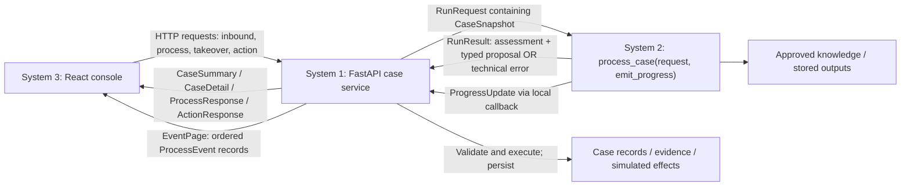
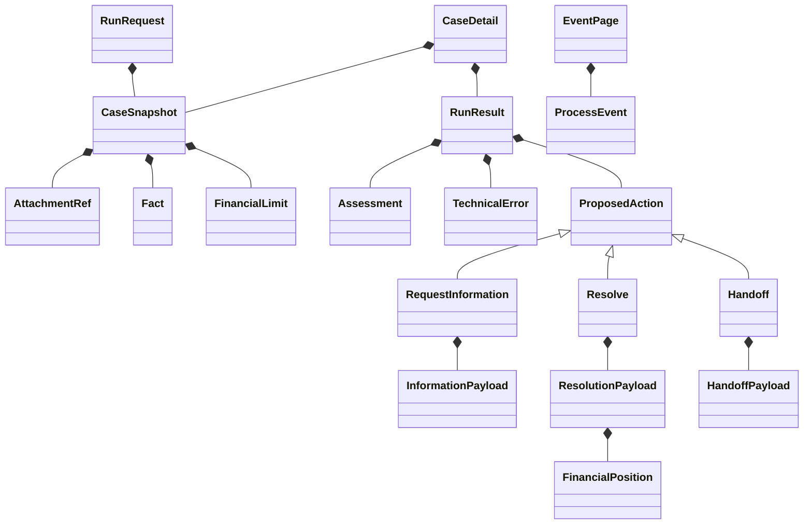

# Executable module contracts

The [subsystem agreement](subsystems-and-contracts.md) governs ownership.
[Shared Pydantic models](../../backend/contracts.py) now define the Python/JSON
boundary; [System 2 protocol](../../backend/ai_service/__init__.py) defines the
synchronous callable shape. The System 2 processor now implements this interface with deterministic offline
demo logic and recorded outputs. HTTP routes remain unimplemented. The older TypeScript exploration is not authoritative.



| Boundary | Input | Output |
|---|---|---|
| List cases | GET `/api/cases` with status/queue/owner filters | `list[CaseSummary]` |
| Read case | GET `/api/cases/{caseId}` | `CaseDetail` |
| Intake / reply | POST `/api/inbound/messages`: `InboundMessageRequest` | `CaseDetail` |
| Upload attachment | POST `/api/cases/{caseId}/attachments`: multipart file | `AttachmentRef` |
| Read attachment | GET `/api/cases/{caseId}/attachments/{attachmentId}` | File bytes with media type |
| Process | POST `/api/cases/{caseId}/process`: `ProcessRequest` | `ProcessResponse` |
| Take over | POST `/api/cases/{caseId}/takeover`: `TakeoverRequest` | `CaseDetail` |
| Human action | POST `/api/cases/{caseId}/actions`: `ProposedAction` without run ID | `ActionResponse` |
| Event feed | GET `/api/events` with caseId/after filters | `EventPage` |
| AI call | `RunRequest`, `ProgressCallback` | `RunResult` |
| AI progress | `ProgressUpdate` | System 1 stamps/persists a `ProcessEvent` |
| HTTP errors | Invalid input / missing resource / conflicting mutation | `ApiError` (422 / 404 / 409) |



All JSON uses camelCase (`model_dump(by_alias=True)`); Python uses snake_case.
Unknown fields are rejected. Action types discriminate their payload schemas.
AI results require matching run, case and version IDs. Failed runs require a
technical error and cannot contain a business action. Money uses nonnegative
integer minor units and a three-letter currency. Timestamps require time zones;
System 1 must emit UTC. Snapshot models prohibit field reassignment and use tuples
for collections; consumers must also treat nested JSON fact values as read-only.

Cross-system additions: common models and the Pydantic dependency. System 1 still
owns route wiring, error handlers (including mapping FastAPI validation failures
to `ApiError`), database transactions, case-scoped attachment resolution, permission
checks, stale-version rejection, idempotency and event sequencing. Schema validation
does not implement those business guarantees. System 2 provides its offline workflow, deterministic snapshots and stored outputs; System 3 still needs to consume these responses.

Validate locally:

```sh
python3 -m venv .venv
.venv/bin/pip install -r requirements.txt
.venv/bin/python -m unittest discover -s tests -p 'test_contracts.py' -v
```
