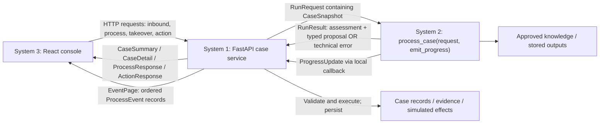
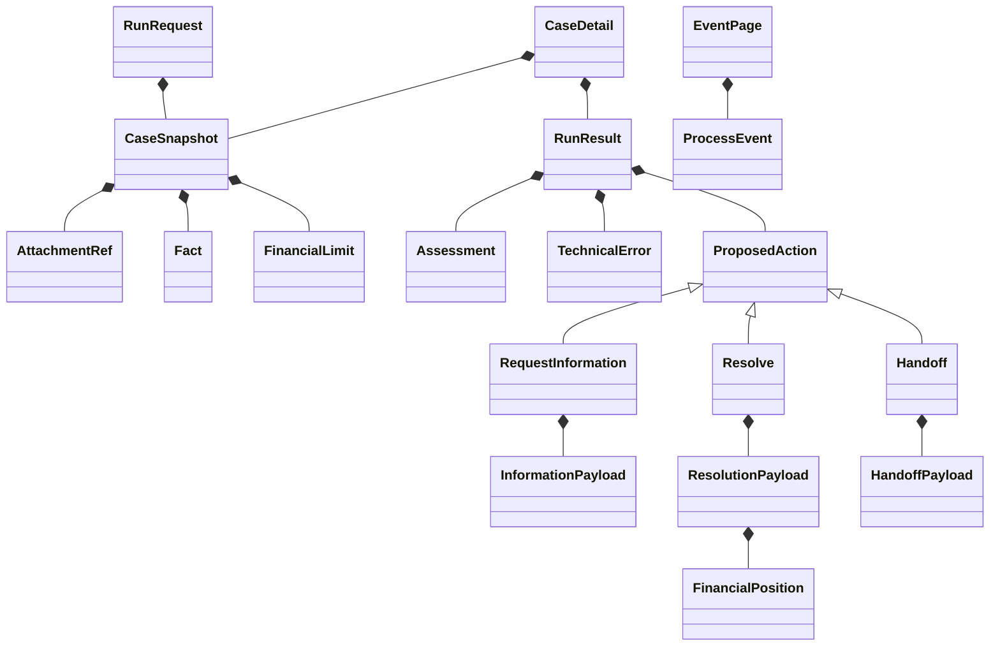

# Executable module contracts

The [subsystem agreement](subsystems-and-contracts.md) governs ownership.
[Shared Pydantic models](../../backend/contracts.py) now define the Python/JSON
boundary; [System 2 protocol](../../backend/ai_service/__init__.py) defines the
synchronous callable shape. The System 2 processor now implements this interface with deterministic offline
demo logic and recorded outputs. The authoritative API is `backend.main:app`: intake, preparation, internal case detail,
processing, takeover and human actions share one SQLite database. `demo_backend.app:app`
is a compatibility launcher and does not open or import its former database. The console
uses the intake request/receipt format below. The older TypeScript exploration is not authoritative.



| Boundary | Input | Output |
|---|---|---|
| List cases | GET `/api/cases` with status/queue/owner filters | `list[CaseSummary]` |
| Read case | GET `/api/cases/{caseId}` | `CaseDetail` |
| Intake / reply | POST `/api/inbound/messages`: `InboundMessage` from `backend/intake_contracts.py` (JSON or multipart metadata + files) | `IntakeReceipt` |
| Customer case | GET `/api/portal/cases/{caseId}` | `PortalCase`, excluding internal fields |
| Upload attachment | Included atomically with intake messages; standalone POST is deferred | Receipt with customer case URL |
| Read attachment | GET `/api/cases/{caseId}/attachments/{attachmentId}` | File bytes with media type |
| Process | POST `/api/cases/{caseId}/process`: `ProcessRequest` | `ProcessResponse` |
| Take over | POST `/api/cases/{caseId}/takeover`: `TakeoverRequest` | `CaseDetail` |
| Human action | POST `/api/cases/{caseId}/actions`: `ProposedAction` without run ID | `ActionResponse` |
| Event feed | GET `/api/events` with caseId/after filters | `EventPage` |
| AI call | `RunRequest`, `ProgressCallback` | `RunResult` |
| AI progress | `ProgressUpdate` | System 1 stamps/persists a `ProcessEvent` |
| HTTP errors | Invalid input / missing resource / conflicting mutation | `{error: ApiError}` (422 / 404 / 409); storage errors 503 |



All JSON uses camelCase (`model_dump(by_alias=True)`); Python uses snake_case.
Unknown fields are rejected. Action types discriminate their payload schemas.
AI results require matching run, case and version IDs. Failed runs require a
technical error and cannot contain a business action. Money uses nonnegative
integer minor units and a three-letter currency. Timestamps require time zones;
System 1 must emit UTC. Snapshot models prohibit field reassignment and use tuples
for collections; consumers must also treat nested JSON fact values as read-only.

System 1 implements route wiring, `ApiError` responses, SQLite transactions,
case-scoped attachments, demo permissions, stale-version rejection, idempotency
and event sequencing. The shared AI call runs outside the database lock; accepted
effects recheck ownership/version so human takeover invalidates an in-flight AI
result. Financial effects are simulated and persisted once. Accepted
`action.applied` events carry `data.actionId` and `data.financialPositions`, which
both UI perspectives use for reimbursement display. System 2 provides its offline
workflow, deterministic snapshots and stored outputs. See the README for Python
3.11+ setup and the integrated demo; schema validation alone does not provide
these business guarantees.

Validate locally:

```sh
python3 -m venv .venv
.venv/bin/python -m pip install -r backend/requirements-lock.txt
.venv/bin/python -m unittest discover -s tests -p 'test_contracts.py' -v
```

Intake uses the shared `CaseSummary` and `EventPage` without parallel versions.
The old `InboundMessageRequest` is retained for earlier design consumers; the implemented
intake model adds subject, strict channels and explicit reply references and does not
accept arbitrary attachment IDs. The unified service provides AI orchestration and full internal case views.


## Unified persistence and projections

Startup applies an additive schema migration to existing intake databases and creates
operation records for runs, idempotent commands, action execution, owners and simulated
financial positions. Event records include nullable runId. Original intake data and file
references are retained. Legacy operations history is deliberately not imported.

Internal CaseDetail includes staff attachment references; a separate processing snapshot
removes original attachment access while retaining extractedDocuments and preparationDiagnostics.
Message direction and subject are explicit. PortalCase excludes operational and internal fields.

System 2's interpretation adapter converts original messages and extracted text into issues
and normalized evidence before assessment. System 1 never classifies completeness in preparation.
Offline interpretation is restricted to stored examples; it never fabricates evidence for
unknown customer input. Financial authority and eligibility checks are supplied internally.

The console accepts an IntakeReceipt, fetches CaseDetail, then calls process explicitly.
Uploads use the atomic inbound multipart contract, not a standalone attachment endpoint.
The reset extension is disabled; use a fresh CONDOR_DATA_DIR. A process starts only on an
AI-owned NEW or IN_PROGRESS case. The transition to IN_PROGRESS increments the version;
the immutable run snapshot uses that version. Stale results remain in run history but cannot
apply effects. The configured demo operator is demo-agent; human reassignment to AI is deferred.
