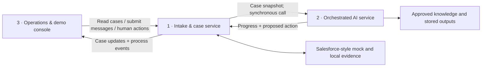

# Subsystems and interface contracts

Status: implementation agreement for the 3-hour Condor Care Hub mockup. Shared
contracts and the integrated demo endpoints are implemented in `backend/contracts.py`
and `demo_backend/app.py`; see README and the verification record for actual checks.

This document translates the subsystem proposal into the scope in [AGENTS.md](../../AGENTS.md). Use the [hackathon plan](../planning/hackathon-plan.md) as business context. Where the broader plan or architecture diagrams imply workers, mandatory approvals, extra channels or large datasets, the current demo scope below takes precedence.

## Scope and development boundaries

Build three logical subsystems in one application: Python/FastAPI/Pydantic, React with JavaScript and Vite, and SQLite/SQLAlchemy. Use local synthetic attachments. Processing is synchronous; no worker, broker or separate service deployment is required.

Start with 6–10 synthetic cases. Simulate AI, email, payments and integrations, label them clearly, and use English UI text. Stored example outputs must support the complete demo without model access. Authentication, extra channels and large datasets are deferred.

| Subsystem | Responsibilities | Owned data and code |
|---|---|---|
| **1. Claim Intake & Case Service** | Accept simulated messages and uploads; correlate replies; expose case lists/details; manage status, ownership and handoffs; execute validated actions; provide the Salesforce-style mock | Authoritative cases, messages, attachments, customer/booking/flight context, financial records and process events; FastAPI routes and persistence |
| **2. Orchestrated AI Service** | Extract evidence; identify issues; assess completeness, severity and sentiment; retrieve approved knowledge; formulate questions, resolutions and handoffs | Synchronous workflow, stored AI outputs, source references, structured assessments and run diagnostics; no direct case writes |
| **3. Service Operations & Live Demo Console** | Show queues and case details; simulate incoming claims/replies; enable human takeover and handling; display activity and, after core flows work, a process graph | React UI and presentation state; all business changes go through System 1 |

System 1 supplies intake capabilities; System 3 owns the minimal demo controls that exercise them. The four-minute pitch now includes a small customer perspective in the same React application, using the same System 1 case and messages. Full accounts and authentication remain deferred. System 2's knowledge fixtures are distinct from System 1's Salesforce-style customer and case records.

The central rule: **System 1 owns the case, System 2 proposes the next action, and System 3 lets people inspect and act.** Valid AI actions execute automatically through System 1. This does not introduce mandatory human approval.



## Contract 1: Case Service ↔ AI Service

Define shared Pydantic models in a common backend contracts module. System 2 exposes an in-process entry point:

```python
process_case(request: RunRequest, emit_progress: ProgressCallback) -> RunResult
```

System 1 creates the run, assembles a complete snapshot, invokes the workflow synchronously, validates the returned action, persists the result, and returns the updated case. No callbacks over HTTP or asynchronous job infrastructure are needed. `emit_progress` is a local function supplied by System 1 for recording progress.

| Model | Required fields / meaning |
|---|---|
| `RunRequest` | `schemaVersion`, `runId`, `caseId`, `caseVersion`, `trigger`, `snapshot` |
| `CaseSnapshot` | Status, owner, language, messages, attachment references, known facts and their sources, identified issues, missing information, customer/booking/flight context and permitted actions/financial limits |
| `AttachmentRef` | `attachmentId`, filename, media type and a case-scoped local reference supplied by System 1; never an arbitrary client filesystem path |
| `RunResult` | `runId`, `caseId`, `basedOnCaseVersion`, `status` (`SUCCEEDED` or `FAILED`), assessment, optional proposed action, optional technical error |
| `Assessment` | Issues, missing facts, severity, sentiment, supporting references and next-action explanation; sentiment alone cannot determine handoff or financial entitlement |
| `ProposedAction` | `actionId`, `caseId`, `expectedCaseVersion`, action type and typed payload; AI actions also identify `runId` |

System 1 supplies customer context and evidence access through the snapshot. Additional data, if needed later, is accessed through a narrow read-only adapter owned by System 1, never through direct database access from System 2.

### Three business actions

| Type | Payload | Accepted effect in System 1 |
|---|---|---|
| `REQUEST_INFORMATION` | Missing facts, reasons and English customer-facing question | Record a simulated outbound question; set `WAITING_FOR_CUSTOMER`; retain the current owner (AI for an AI request) |
| `RESOLVE` | Outcome, explanation, source IDs/versions, English reply and separate financial positions | Record simulated reply and any permitted financial action; set `RESOLVED` |
| `HANDOFF` | Reason code, suggested queue, summary, facts, evidence, unresolved questions and prior attempts | Set `WAITING_FOR_SPECIALIST` and route to the appropriate human queue |

Financial positions distinguish compensation, ticket/expense reimbursement and voluntary goodwill. Amounts use integer minor units and an explicit currency. Unsupported authority or approval requirements cause a prepared handoff; a full budget administration screen is outside the core demo.

Technical failure is a run result, not a fabricated business decision. System 1 records the error, preserves the case and supports manual handling. Retrying must not duplicate messages or financial actions.

System 2 checks the recommendation's substance. System 1 independently checks current case version, owner, permitted transition, required approvals and financial authority before executing it. A valid simulated AI result can proceed without a human click.

### Case state and handoff reasons

Shared status values: `NEW`, `IN_PROGRESS`, `WAITING_FOR_CUSTOMER`, `WAITING_FOR_SPECIALIST`, `RESOLVED` and `CLOSED`. Keep owner type (`AI`, `HUMAN` or `QUEUE`) separate from status.

- Clear case: `NEW → IN_PROGRESS → RESOLVED`.
- Evidence loop: `IN_PROGRESS → WAITING_FOR_CUSTOMER → IN_PROGRESS → RESOLVED`.
- Handoff: `IN_PROGRESS → WAITING_FOR_SPECIALIST → IN_PROGRESS` with a human owner, then `RESOLVED` after the human action.
- A new relevant message can reopen a resolved or closed case for reassessment. Preserve human ownership if the case was taken over.

Use explicit handoff reason codes: `UNSUPPORTED_ACTION`, `SERIOUS_ISSUE`, `UNRESOLVED_CONFLICT`, `UNCLEAR_RULE`, `AUTHORITY_LIMIT` or `TECHNICAL_FAILURE`. Missing evidence alone is not a handoff reason. A failed run remains visible and manually recoverable; it never silently resolves a case.

## Contract 2: Operations Console ↔ Case Service

Use JSON over HTTP. Pydantic models are the schema source of truth. React consumes these contracts without importing backend implementation details.

| Endpoint | Request / response |
|---|---|
| `GET /api/cases?status=…&queue=…&owner=…` | Returns case summaries: ID, subject, status, category, owner, queue, priority, next action and version |
| `GET /api/cases/{caseId}` | Returns full case detail, messages, attachments, facts, source references, run results and history |
| `POST /api/inbound/messages` | Accepts `messageId`, channel, sender, body, attachment IDs and optional existing case/thread reference; returns the created or updated case |
| `POST /api/cases/{caseId}/attachments` | Accepts a multipart synthetic file upload; returns `AttachmentRef` |
| `GET /api/cases/{caseId}/attachments/{attachmentId}` | Serves an attachment associated with that case |
| `POST /api/cases/{caseId}/process` | Accepts `requestId` and `expectedCaseVersion`; runs System 2 synchronously and returns the run result, applied action and updated case |
| `POST /api/cases/{caseId}/takeover` | Accepts `actionId`, `expectedCaseVersion` and a configured demo operator ID; atomically assigns the human owner |
| `POST /api/cases/{caseId}/actions` | Accepts a human action using the shared action envelope; returns the updated case and execution result |
| `GET /api/events?caseId=…&after=…` | Returns ordered events and a cursor for the next poll; an omitted cursor starts from the beginning |

For the demo, the console explicitly submits a message and then calls `/process`; it must not also trigger an implicit second run. A received reply reopens reassessment on the existing case. Human-owned cases require an explicit reassignment before automated processing resumes.

Demo identities are fixed fixtures, not real authentication. Ordinary clients cannot grant themselves authority or choose arbitrary financial limits. Enforce the supported demo roles/actions in System 1. Authentication and production access control remain deferred.

### Common behavior

- Stable opaque IDs identify cases, messages, actions, runs and attachments. Timestamps use UTC ISO 8601 strings.
- `caseVersion` increases on accepted business mutations, including new evidence and takeover. Progress events do not change it.
- Every mutation carries an idempotency key (`messageId`, `requestId` or `actionId`). Repeating the same key and payload returns the original result; reusing a key with different content is a conflict.
- Stale case version, owner conflict and invalid state return `409` with a machine-readable error code. Invalid input returns `422`; unknown resources return `404`. Responses include a safe message and, where applicable, current case version.
- Temporary failures are retryable only with the original idempotency key. A stale result needs fresh assessment, not blind retry.
- Only System 1 modifies authoritative case records. It validates and applies business changes atomically.
- Human takeover wins: an AI action based on the previous owner/version is rejected even if its synchronous run finishes later. Cancellation infrastructure is not required.

## Contract 3: Events for activity, graph and replay

System 1 records both its own business events and System 2's progress. System 3 reads one event feed; it never needs to call the AI Service directly.

```json
{
  "schemaVersion": 1,
  "eventId": "evt-042",
  "caseId": "case-123",
  "runId": "run-007",
  "sequence": 42,
  "type": "step.completed",
  "stepId": "retrieve_policy",
  "timestamp": "2026-10-30T12:00:00Z",
  "summary": "Two relevant demo policies found",
  "data": {
    "sourceIds": ["policy-01", "policy-04"],
    "simulation": true
  }
}
```

Use stable step IDs: `intake`, `extract_evidence`, `assess`, `retrieve_policy`, `validate_action`, `request_information`, `wait_for_customer`, `send_reply` and `human_handoff`. Each step can emit started/completed/failed events. Business events include `case.updated`, `owner.changed`, `action.applied` and `run.failed`.

`sequence` is monotonically increasing in the event feed and acts as the polling cursor. Non-AI events can have a null `runId`. Keep summaries safe for display and include references rather than raw attachment contents.

AI progress describes activity; only accepted actions change business state. The UI maps step IDs to graph nodes and uses event order to highlight actual transitions. A minimal activity timeline comes first. A graph is added only after the core flows work.

For actual live updates, record progress as it happens and poll while the processing request is running; the backend must remain able to serve reads. If the demo instead animates stored events after processing, label it as replay. Neither approach requires a worker or broker.

## Independent development and integration checks

Agree on the shared Pydantic contracts and three deterministic fixture cases first. Keep fixture IDs, expected actions and source IDs consistent across teams.

| Team / subsystem | Can develop independently against | Acceptance scenario |
|---|---|---|
| 1: Intake & Case Service | A fake `process_case` function returning the three action types | Creates one case per message/thread, applies actions once, retains evidence/history and rejects stale actions |
| 2: Orchestrated AI Service | Fixed snapshots, local attachments and approved knowledge fixtures | Complete case resolves; missing evidence requests information then resolves after a reply; serious/unsupported case produces a reasoned handoff |
| 3: Operations Console | Recorded JSON responses and event fixtures matching the contracts | English case list/detail, simulated reply, human takeover and visible action history; loading and error states are clear |

Do not hand off merely because information is missing, the customer is angry or multiple supported issues are present. Serious issues, unsupported actions, unresolved contradictions or authority limits require a specific handoff reason. A clear supported case has no mandatory human approval step.

Integrate the three flows before adding graph polish or metrics. Check duplicate submission, stale AI result after takeover, simulated reply on the same case and operation without model access. Reserve the final 30 minutes for demo checks and fixes; record only checks actually performed.

## Relationship to the broader architecture

The [editable architecture](condor-claims-architecture.drawio) and [workflow preview](condor-claims-workflow.png) remain the broad framing. Large synthetic datasets, background jobs, full budget administration, extra channels, real integrations and production authentication are deferred. They are not dependencies of these three subsystem deliveries.
