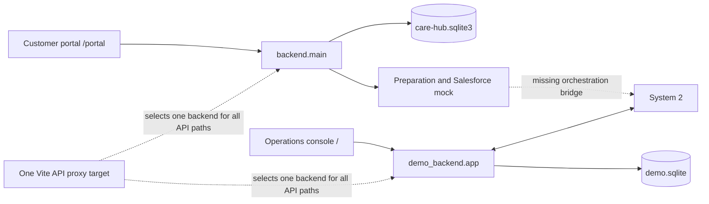

# Condor Care Hub end to end audit

The seeded operations demo works. The entire application is **not yet connected end to end**: customer intake/preparation and operations/AI execution use separate case stores and incompatible HTTP contracts. New free-text claims also expose decision errors that the fixture-based tests do not catch.

Audited on 30 October 2026, Windows, Python 3.14.0 and Node 24.11.1. Final application revision: **`1660d21`** (includes remote System 2 update `8727444`). Initial checks ran at `5bf9a3d`; the full Python suite, frontend tests/build, all 29 HTTP probes and three core browser flows were repeated from an isolated checkout of `1660d21`. All exercised messages, uploads and payments were synthetic; AI and preparation were explicitly offline. Existing user databases were not reset.

## Update and preservation

- Fetched and fast-forwarded main, resolved five documentation/configuration conflicts, then committed and pushed the combined work as `5bf9a3d`.
- Preserved the remote operations frontend, tests, dependency lock and configurable proxy. Restored the local customer portal at `/portal`, loading its styles separately from the operations console.
- Combined environment examples and documented the two backend startup paths. Preserved local intake/preparation code, fixtures, tests and notes.
- Kept the pre-update Git stash as a recovery copy. Overlapping earlier frontend configuration remains recoverable there; it was reconciled with the remote configuration rather than overwriting it.
- During the audit, remote main advanced to `8727444`; its System 2 changes were merged and pushed as `1660d21`. A separate `feature/unified-system1` task then started a merge in the shared working folder. That in-progress merge was left untouched. Final checks used an isolated `codex/e2e-audit` checkout; this report does not certify that later unified implementation.

## Checks actually performed

| Check | Result | Scope and qualification |
|---|---|---|
| Earlier suite at `5bf9a3d`, native Windows encoding | 105 passed, 1 failed; 85 subtests passed | The failure reads a UTF-8 evaluation artifact using the platform's default encoding. The same earlier suite passed 106 tests with `-X utf8`. |
| Final full Python suite with `-X utf8` | **205 passed, 2 failed; 143 subtests passed** | Includes intake, preparation, contracts, AI routing, scoped evidence, local retrieval, mocked provider calls, data pipeline and operations API. Both failures are Windows SQLite cleanup in `tests/test_email_delivery.py`. An additional engine cleanup traceback occurs at interpreter exit. |
| Frontend tests | **10 passed in 3 files** | Component/API tests use mocked fetch. They are not full browser integration tests and do not cover the current portal component. |
| Frontend production build | **Passed** | Both portal and operations bundles built. Browser flows used the Vite development servers, not the production bundle. |
| Python dependency compatibility | **Passed** | `pip check`: no broken requirements. |
| Standalone offline AI evaluation | **19/19 scenarios passed** | Repeated on the final revision; snapshots and proposed actions, not customer-to-operations integration. |
| New synthetic legal fixtures | **20/20 executed without technical failure** | 19 handoffs and one information request. The script validates fixtures and runs proposals; it does not score legal acceptance criteria. |
| Additional live HTTP audit | **11/29 expectations met; 18 gaps reproduced** | Two isolated local servers. Some expectations describe the intended unified contract, which the current separate slices do not implement. [Exact expected/observed results](end-to-end-audit-2026-10-30.json). |
| Policy package validation, working checkout | **Failed** | Byte-hash manifest differs after Windows CRLF conversion. |
| Policy package validation, isolated Git-byte copy | **Passed** | 49 rules, 30 sources, 9 templates and 24 table checks. Not application execution of the 20 legal/workflow acceptance specifications. |

The first Python attempt also encountered an inaccessible pytest temporary folder. Re-running with a fresh repository-local `--basetemp` resolved that environment problem. Five pinned raw source files had CRLF bytes while their manifest and Git blobs expected LF. Their contents differed only by line endings; restoring the verified Git bytes made pipeline checks pass. The committed `.gitattributes` already protects these raw files on future checkouts.

The expanded suite initially could not collect four retrieval test modules because the optional `qdrant-client` and NumPy dependencies were absent. Installing `requirements-rag.txt` and `requirements-extraction.txt` enabled the final run. Retrieval tests used in-memory Qdrant and fake embeddings; no hosted vector service or live embedding model was exercised.

An existing Vite process held `esbuild.exe` open and prevented `npm ci`. That project process was stopped, the locked dependencies were installed, and tests/build succeeded with normal filesystem access. Restricted execution had separately failed to load the Vite configuration.

## Browser verification

| Flow | Observed result |
|---|---|
| Clear seeded case | `NEW` to `RESOLVED`, one simulated reply and EUR 42 reimbursement visible. |
| Missing evidence | AI requests amount/currency, keeps AI ownership, accepts `42.00 EUR` on the same case, resolves at version 4 with four messages. |
| Serious seeded case | `SERIOUS_ISSUE` handoff visible; takeover enables human reply and disables AI processing; human reply resolves the case. |
| Angry but supported case | Automatically resolves; sentiment alone does not cause handoff. |
| Unsupported seeded case | One-click demo hands off to specialists and opens explicitly labelled recorded-event replay. |
| Customer portal | New submission produces a case receipt/link; follow-up PNG upload stays on the same case. Correspondence and attachment survive browser reload. |
| Attachment retrieval | Browser-displayed attachment URL returns HTTP 200, `image/png`, 66,803 bytes. |
| Replay | Next event, play/pause and 4:3/16:9 format controls work. Evidence case remains resolved at version 4 with four messages after replay. |
| Backend mismatch | `/portal/cases/case-evidence` against the operations backend shows the generic request error; its customer projection endpoint returns 404. |
| Browser errors | No warning/error console entries were captured on the successful operations and portal tabs at the inspected checkpoints. |

The portal submission's preparation result was `READY_WITH_ERRORS` for arbitrary audit text and the hotel image. Offline extraction uses exact stored outputs, so successful intake does not imply general-purpose evidence extraction. The UI did not show that internal preparation diagnostic.

The actual in-app viewport remained narrow (605 CSS pixels in the measured checkpoint) despite requesting a desktop viewport override. The override was reset. A full responsive-device matrix and fullscreen mode were not verified.

## What collides



| Boundary | Intake implementation | Operations implementation | Consequence |
|---|---|---|---|
| Persistence | Normalized cases, messages, files, preparations | JSON case documents plus events/commands | A customer case is absent from the operations store. Both define `cases`/`events` with incompatible columns; sharing a SQLite filename cannot integrate them. |
| `POST /api/inbound/messages` | Subject and explicit email reply parent; JSON or multipart; returns receipt with `caseVersion` and customer URL | No subject/reply-parent fields; JSON and attachment IDs; returns `CaseDetail` with `version` | Portal payload receives 422 from operations; console reply receives 422 from intake. |
| Case access | Customer projection, preparation APIs | Internal detail, process, takeover, human actions | Neither server supplies the complete app API. |
| Upload | Atomic with message; five validated PDF/JPEG/PNG files, 10 MiB each | Separate upload; arbitrary type, 2 MB, no command key | Different limits, validation, retry behavior and attachment/message associations. |
| Errors | `{error: {code, message}}` | Top-level `{code, message, currentCaseVersion}` | Each frontend adapter loses useful messages from the other backend. |
| Events | Optional case filter, 200-record page and cursor | Required case filter, unbounded result | Console fetches one page and does not follow cursors, which would truncate activity after integration with the intake feed. |
| Seed identities | `case-clear` means flight delay; `case-evidence` means hotel expenses and a stored request | Same IDs mean meal expense fixtures with different facts/statuses | Same ID is not the same business case across the stores. |
| Preparation | Sourced documents and mock enrichment, no decisions | Fixture-derived snapshots, narrow amount parser, no preparation call | Uploaded evidence does not flow through preparation into the operations decision. |
| AI configuration | `CONDOR_PREPARATION_MODE=offline/live` | `AI_MODE=offline/auto/openai` | Separate modes need deliberate configuration. The latest launcher honors explicit offline mode, defaults to openai, and preserves failed runs on provider errors. |

The shared wire contracts also retain `questionDe` and `replyDe` while carrying English content. That is a naming collision with the supplied English-only API-field requirement; migrating those names needs coordinated backend/frontend changes rather than an isolated rename.

The preparation run adapter emits empty `issues` and `attachments`. System 2 currently routes empty issues to `UNSUPPORTED_ACTION`; it does not implement classification from the prepared text. Wiring the existing adapter directly into `/process` would therefore not complete integration. Preserve the preparation boundary and add explicit classification/orchestration before action execution.

## Prioritized findings and reproductions

### P1 — Unify the case service before claiming a complete app

**Evidence:** A successful portal submission is 404 in the operations store; operations has no portal projection; intake has no internal detail or `/process`. The reverse inbound payloads both return 422.

**Affected:** `backend/main.py`, `backend/database.py`, `demo_backend/app.py`, `frontend/vite.config.js`, both frontend API adapters.

**Next change:** Choose one authoritative System 1 store and action executor. Keep the customer projection separate, adapt both clients to the same intake contract, and carry preparation output into the current case snapshot. Define one meaning and initial state for each shared fixture ID. Do not bridge this by running two writers over one SQLite file.

### P1 — New serious facts and unsupported topics can receive reimbursement

**Reproductions, all observed through real HTTP requests:**

1. Create a meal claim without evidence, process it, then reply `I suffered a serious injury on board. The meal was 42.00 EUR.` Processing returns `RESOLVE`, not a serious handoff.
2. Create `I was seriously injured on board. My expenses were 42.00 EUR.` Processing returns `RESOLVE`; the substring classifier recognizes `injury` but misses `injured`.
3. Create `My suitcase was destroyed. Replacement cost was 42.00 EUR.` Processing returns `RESOLVE` using meal expense policy, rather than asking baggage-specific questions or handing off unsupported adjudication.

**Cause:** `demo_backend/app.py:fresh/inbound` builds real inbound cases from preclassified fixture snapshots, including meal purpose and eligible/no-prior-payment context. Replies update amounts but never refresh issues. System 2 trusts those supplied issues.

**Next change:** Classify the full current complaint and new allegations before every decision. Never import receipt purpose or verified eligibility merely by selecting a fixture. Add integration regressions for new serious evidence and non-expense categories; preserve automatic clarification for supported missing evidence.

### P1 — A negative receipt amount becomes a positive payment

**Reproduction:** Submit `Please reimburse my meal. The receipt adjustment is -42.00 EUR.` and process. The result resolves with a positive EUR 42 reimbursement.

**Cause:** `demo_backend/app.py:extract_receipt` starts its match after the minus sign. The parsed positive integer passes financial authority validation.

**Next change:** Parse signed monetary tokens, reject/clarify negative adjustments and preserve conflicting facts. Test amount parsing through intake and action execution, not only prebuilt financial positions.

### P2 — Clarification and handoff history are incomplete

- Replying only `The currency is EUR.` still requests `receipt_currency`, because extraction recognizes only an amount immediately followed by EUR.
- After clarification attempts and a `150.00 EUR` reply, the authority-limit handoff is correct but `priorAttempts` is empty. `backend/ai_service/workflow.py` compares message sender to `demo-ai`; actual service messages use `condor-service@example.com`.
- An ordinary reply to a queued specialist case changes `WAITING_FOR_SPECIALIST` to `IN_PROGRESS`. Queue ownership remains intact, but dashboard specialist counts and routing status no longer describe the waiting case.

**Next change:** Extract supplied fields independently, use explicit message direction/actor identity, and preserve specialist status when accepting customer evidence. Add an explicit human-to-AI reassignment path if returning human cases to automation is in scope; none is currently implemented.

### P2 — Upload and message semantics differ across entry points

The operations API accepts whitespace-only messages, invalid sender strings and HTML attachments; it rewrites a `PORTAL` message to `EMAIL`. Repeating an upload creates another attachment ID and increments the case version. These are proven differences from the stricter intake implementation; the audit does not claim an attachment exploit.

**Next change:** Reuse intake validation, direction/channel metadata, atomic file association and idempotency handling in the unified service. Align limits and error payloads before switching the frontend proxy.

### P2 — Windows setup and verification are not reproducible as documented

- The default Python test command fails one evaluation-artifact comparison on UTF-8 characters. Use explicit `encoding='utf-8'` in the test's file reads; `-X utf8` demonstrated the cause.
- The two failing email-delivery tests use `with sqlite3.connect(...)`, which commits/rolls back but does not close the connection. Windows cannot delete `outbox.sqlite3` during cleanup. Use `contextlib.closing` or an explicit close in those tests. The implementation already uses closing.
- The operations/evidence test modules retain an open SQLAlchemy engine when their temporary directory is cleaned. Windows reports a locked database at interpreter exit. Dispose the test engine before cleanup.
- The policy manifest hashes raw bytes and lacks line-ending protection. All 12 manifest inputs/outputs matched after CRLF-to-LF normalization; an isolated copy of Git blobs validated successfully. Pin their line endings instead of rebuilding platform-specific hashes.
- `start.sh` assumes `.venv/bin/python` and Bash/Python 3.13 provisioning. This Windows checkout uses `.venv/Scripts/python.exe`. The updated shell launcher now honors explicit `AI_MODE=offline` and keeps provider failures visible, correcting the earlier forced-live/fallback behavior. It still checks only whether Vite exists before deciding to install frontend dependencies.

**Next change:** Provide a Windows launcher and make dependency setup follow the lockfile and include test extras when running the full suite. Keep the runtime startup paths and tested interpreter requirements consistent in README/AGENTS.

### P2 — The current tests prove components more strongly than the complete journey

Frontend tests mock HTTP and include the removed `CustomerView` component. System 2 evaluation uses supplied issue/fact snapshots. The operations integration suite tests the seeded meal flows well, including duplicate payments and takeover during a run, but does not cover the customer portal's API contract or newly introduced serious facts.

**Next change:** Make customer submission → preparation → operations list → automatic question → uploaded reply → resolution a shared-store integration gate. Add the serious-follow-up and negative-amount regressions above. Keep a real-browser smoke test for each core flow and ensure the production build is served during at least one smoke run.

## Missing versus intentionally deferred

Missing for the requested combined demo: shared persistence, one inbound/attachment contract, prepared-evidence classification, an operations preparation/retry view, customer-visible outcomes from operations actions, canonical fixtures, and regression coverage across those boundaries. The operations UI also lacks a new inbound email form; it can simulate replies to existing cases, while new intake is API-only or through the separate portal.

The merged System 2 adds scoped evidence adapters, extraction/reconciliation, approved knowledge retrieval, diagnostics and separate legal research retrieval. The operations backend still calls the unconfigured processor: it does not bind the readers or diagnostic sink. The simulated email outbox also remains a standalone adapter. The AI action workflow uses approved synthetic expense policy v2; legal research results do not authorize payments. The operator-policy package remains a draft, and its 20 legal/workflow specifications are not application tests. Connecting the broader policy package is separate work and does not establish real-world legal entitlement.

Authentication, real email, actual payments, real Salesforce, workers, brokers, large datasets and production load/security certification remain deliberately outside the hackathon scope. Live model/provider behavior, production-bundle browser serving, multi-browser/device accessibility and fullscreen were not tested in this audit.

## Reproduce

From a checkout of `1660d21`, with installed backend dependencies plus `requirements-rag.txt` and `requirements-extraction.txt`, and new disposable data paths:

```powershell
$env:AI_MODE = 'offline'
$env:CONDOR_PREPARATION_MODE = 'offline'
./.venv/Scripts/python.exe -X utf8 -m pytest backend/tests tests demo_backend/test_api.py -q -p no:cacheprovider --basetemp=CondorCaseOpenAIHackathon/tmp/audit-new-run
./.venv/Scripts/python.exe -m pip check
./.venv/Scripts/python.exe -m backend.ai_service.evaluation --output CondorCaseOpenAIHackathon/output/audit-ai
```

Run `npm ci`, `npm test` and `npm run build` from `frontend`.

The final frozen-checkout run used ports 8021/8022 and frontend 5184; the following example uses 8011/8012. Start `demo_backend.app:app` on 8011 with `DEMO_DB` pointing to a new test SQLite file. Start `backend.main:app` on 8012 with `CONDOR_DATA_DIR` pointing to a new test directory. Then:

```powershell
./.venv/Scripts/python.exe tests/audit_http.py --operations http://127.0.0.1:8011 --intake http://127.0.0.1:8012 --output CondorCaseOpenAIHackathon/output/audit-http.json
```

This probe creates synthetic cases and exits 1 while expectations remain unmet. It never resets a server. For browser checks, use separate Vite instances on 5174 and 5175 with their `API_PROXY_TARGET` set respectively to ports 8011 and 8012; use `/` for operations and `/portal` for intake.

## Recommended implementation order

1. Unify System 1 persistence and HTTP contracts while preserving the customer-only projection and preparation boundary.
2. Stop incorrect resolution for serious follow-ups, unclassified topics and signed/conflicting amounts.
3. Connect preparation, classification, action execution and customer-visible correspondence for all three flows.
4. Repair clarification memory, handoff context, specialist-state preservation and upload retry behavior.
5. Make Windows/offline startup and the combined regression suite reproducible; then repeat this audit on the unified implementation.
